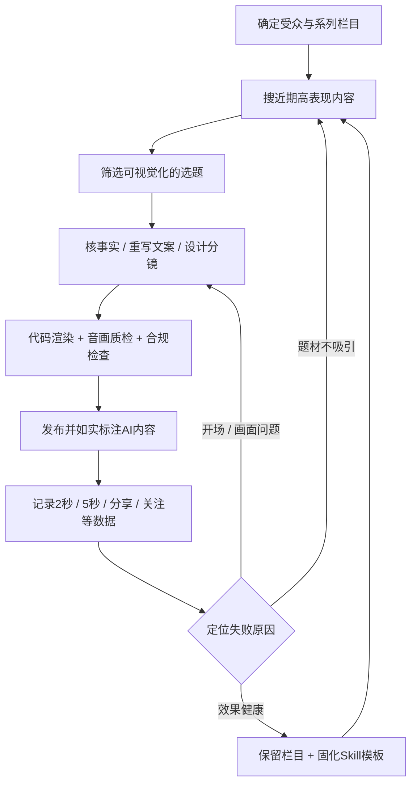

# 抖音 AI 知识号：从 0 起号到代码出片的完整研究

> **一句话结论：**用 **`Azure12355/weilanx-claude-videos`** 当知识视频制作主工程，Claude Code / Opus 5.5 负责策划与编写动画代码，Remotion 负责渲染，ffmpeg 负责音视频处理；用 **`lemomo-ai/lemo-opuscar`** 作为风格补充。运营上学习蔚蓝的「选题→原创表达→发布→复盘」闭环，但不要把其个人样本推演为抖音的官方算法规则。

**研究日期：**2026 年 10 月 20 日  
**适合人群：**没有编程经验、希望做中文抖音知识动画账号的个人创作者。  
**信息来源说明：**本报告依据你提供的四条 X 帖摘录及整理材料，并核验公开 GitHub 仓库 README、安装指引和国家网信办规定。X 原帖在此次检索中返回访问限制（403），**没有完整逐字核实到原帖**；因此帖中成绩、账号阈值、运营秘诀均标记为「作者自述/待复核」，绝不冒充独立实测数据。

## 目录

1. [核心判断：四条 X 帖各做什么](#一核心判断四条-x-帖各做什么)
2. [抖音起号：如何把九步 SOP 变成稳健方案](#二抖音起号如何把九步-sop-变成稳健方案)
3. [视频制作：从一句选题到一条 MP4](#三视频制作从一句选题到一条-mp4)
4. [开源仓库与 Skill 资源地图](#四开源仓库与-skill-资源地图)
5. [推荐技术架构、目录与可复制命令](#五推荐技术架构目录与可复制命令)
6. [可直接复制的 Claude Code 提示词](#六可直接复制的-claude-code-提示词)
7. [首周执行表、实验设计与复盘表](#七首周执行表实验设计与复盘表)
8. [常见陷阱、版权与 AI 标识](#八常见陷阱版权与-ai-标识)
9. [来源与 GitHub 链接总表](#九来源与-github-链接总表)

---

## 一、核心判断：四条 X 帖各做什么

| 原帖 | 真正提供什么 | 应如何使用 | 证据定位 |
|---|---|---|---|
| [蔚蓝（zureA255062）](https://x.com/zureA255062/status/2111642497927798995) | 知识号从注册、找对标、创作、投放到复盘的个人 SOP；附代码出片工程 | **运营主线 + 主工程** | 运营经验主要来自你提供的摘要；工程可由 GitHub 核验 |
| [Eian](https://x.com/EianLu/status/2112348077248204814) | 代码视频与大量风格样例，强调以 Skill 降低制作门槛 | **视觉风格储备 / 产能参考**，非平台运营法则 | 仓库可核验；流量与商业线索为作者自述 |
| [麦当（czzzzzzJ_）](https://x.com/czzzzzzJ_/status/2112085934267346976) | 各类 Opus 代码视频仓库、提示词、样板工程的检索地图 | **按需找素材和学习案例** | 各具体仓库可核验 |
| [midudev](https://x.com/midudev/status/2111135757263941901) | Claude Code 图片预览、额度显示、提交代码等开发插件 | **开发舒适度补充**，与抖音起号无直接关系 | GitHub 插件清单可核验 |

**主线不是“找一个 AI 视频模型连续抽卡”。**这些项目的典型工作方式是：由模型生成 HTML / Canvas / SVG / React / Three.js 动画程序，再使用浏览器或 Remotion 按时间/帧渲染画面，交给 ffmpeg 合成视频。这样更容易精确控制字幕、配色、镜头节奏和同系列统一风格，代价是环境准备和调试复杂度更高。[S1][S2][S3]

### 蔚蓝案例：可参考，不是业绩承诺

据你提供的帖文摘要，作者分享过如下个人案例：一条视频约在不到两天内达到 108 万播放、2.7 万赞、6 万分享、带来 462 粉；该条 2 秒跳出率约 22%；约 29 条作品中只保留 10 条对外展示；还提到一次 30 元抖加活动。**这些数字未能在本次检索中独立核对**，只说明作者提供过这一样本，不证明照做就能复现。

特别注意：**播放量、点赞量、分享量、粉丝增长是不同指标**。一个视频爆发不等于账号增长效率高，更不等于变现成立。需要把「播放→主页访问→关注→私信/转化」分开记录。

---

## 二、抖音起号：如何把九步 SOP 变成稳健方案

先建立正确的整体认识：



### 2.1 第一步：账号定位——不要把“泛知识”做成“完全随机”

**帖文思路：**先用「知识分享」这一较宽的定位测试热点，让高表现内容帮助发现方向。  
**更稳健的执行版：**账号定位可以宽，但至少固定一个**受众承诺**和两三个**内容支柱**，例如：

- 受众承诺：**“用动画把反直觉的小知识讲明白”**。
- 栏目 A：生活中的数学错觉（概率、定价、排队、时间）。
- 栏目 B：互联网和 AI 原理（可验证、避免夸张技术结论）。
- 栏目 C：历史决策/博弈（必须核对出处）。

**原因：**平台能为单条作品匹配用户，长期关注却取决于“点进主页后知道未来还能看到什么”。如果今天科普博弈、明天纯搞笑、后天游戏集锦，同一个观众通常缺乏关注理由。风格也应固定为 1 种主色系、1 种文字排版、1 套开头节奏，而不是把 51 种风格随机混发。

### 2.2 第二步：包装账号——让陌生人能一秒看懂

按原帖思路可尝试：简短好记的昵称、缩小后仍清晰的头像、统一的背景视觉、简介明确说明“看账号能获得什么”。

**建议模板（自行调整，不要复制别人昵称或美术资产）：**

- 昵称方向：`观念实验室` / `一眼懂了` / `反常识局`（仅供命名灵感，注册前搜重名）。
- 简介：`每天用一段动画，讲清一个让你“原来如此”的知识点。`
- 主视觉：深色背景 + 一种明亮强调色；缩略图能认出栏目。
- 主页置顶或较早作品：回答「这个账号讲什么」「为什么值得关注」。

> 作者提到的「Vibe知识大赏」可以作为**当期选题入口**，但不宜假定活动一直存在或特定标签永久享有推荐权。发布前查看抖音端活动页面和当期规则。

### 2.3 第三步：正常使用账号，不做机械化“养号”

帖文提出：注册后先正常刷知识视频约 1–2 小时、点赞、偶尔评论，再发片。

**需要纠偏：**目前没有在本次核验中找到可靠官方证据，证明“刷满固定小时数就能开启流量池”。推荐的动作是：完成实名/安全设置（如账号需要）、完善资料、正常浏览同领域内容并研究选题，避免批量账号、自动点赞评论或异常互动。把时间用来**研究受众和内容**，而不是“骗系统当真人”。

### 2.4 第四步：对标——重点看“近期相对表现”，不是只看最热视频

建立至少 20 条候选选题表，记录：

| 字段 | 记录方式 | 为什么重要 |
|---|---|---|
| 对标链接、发布时间 | 原视频 URL、公开时间 | 判断内容是否具有新鲜度 |
| 发布者体量 | 粉丝级别、历史平均表现（若可见） | 区分大号自然传播优势 |
| 当前观看/互动 | 当时可见数值，注明采样时间 | 后续比较增长，不把快照当终局 |
| 评论关键词 | 观众争论/误解/追问 | 找真正有讨论价值的问题 |
| 可视化难度 | 低 / 中 / 高 | 决定代码动画是否适配 |
| 可信来源 | 原始论文、官方数据、文献 URL | 排除无法证实的“假知识” |
| 差异化切口 | “我的内容多解释哪一点” | 防止换皮搬运 |

**优先级建议：**最近出现热度、可画成一个简单模型、对小体量账号也有表现、能找到第一手资料、可以用更易懂的方式讲述。**“爆过就一定还能爆”不是普适规律。**

### 2.5 第五步：学结构、不搬运

可以学习：矛盾设置、三幕式讲述、知识解释顺序、视觉节奏、转场类型、栏目包装思路。

必须自己完成：文案、具体图像构成、配音、可授权的配乐、封面和标题。未经许可不得照搬他人的原片、原声、字幕、水印或专有视觉素材。不要以“换个颜色 / 去个水印 / 换个配音”冒充原创。

**差异化公式：**同一公共知识点 + 不同问题切入 + 自己的事实证据 + 新的动画推演 + 自己的解读。

### 2.6 第六步：每条视频只优化三个核心

1. **第一帧就交代冲突：**一眼看懂这条在讲什么，而不是空白 Logo 飞 3 秒。
2. **解释更直观：**一句知识点对应一个视觉动作。尽量用生活物体、动态比例、移动人物/天平/计时器代替一屏抽象文字。
3. **声音跟画面同节奏：**先测可用音乐的节拍与时长，再把标题、转折、锚词对到拍点上；人声高于背景乐，避免音量忽大忽小。

帖子提到的“重拍前约 0.75 秒收暗、最后 3 帧静止、重拍打出 2–4 字锚词”，可作为**待 A/B 测试的剪辑手法**，不是所有视频都必须遵守的准则。

### 2.7 第七步：发布节奏——不要被“每天 3–5 条”绑架

原帖报告了 3–5 条/天、间隔 3–4 小时的节奏。对新手的**实际建议**是：先在一周内做出 3–5 条经过质量检查的作品；明确方向、成本可控后，再测试每天 1–3 条甚至更高频。频率不是目标，**可持续的原创质量 + 可复盘的数据**才是目标。

发布前确认：

- 主视频建议从 **9:16 竖屏（例如 1080×1920）**开发与验收；不要将仓库里的 16:9 样片直接压缩变形。
- 作者使用 **3:4 封面**：作为其具体做法保留，但封面展示比例、裁切和安全区域以当前抖音客户端预览为准。
- 标题尽量短、前置悬念或认知冲突；“不超过 20 字”是原帖操作习惯，**不要误称为平台一切场景的统一规则**。
- 描述第一句承接钩子；活动标签（如 `#Vibe知识大赏`）要确认当前活动仍适用。
- AI 生成/合成内容要按平台功能如实声明，相关要求见第八章。

### 2.8 第八步：看数据——诊断内容，不迷信“6 小时生死线”

原帖主张发布后 6 小时复查，根据从个位数到几千的播放做不同处理。**建议把 6 小时作为第一次观察点，而非最终裁决。**对新账号也同时看发布后 24 小时和 72 小时，考虑后续分发、搜索流量、发布时间和样本波动。

| 现象 | 优先核查 | 下一动作 |
|---|---|---|
| 2 秒跳出明显偏高 | 首帧是否空、标题是否模糊、是否铺垫过长 | 重做开头 1–2 秒，保留其他因素重试新选题 |
| 5 秒表现较好但完播差 | 中段是否重复、解释是否冗长、镜头是否停滞 | 缩短解释链、加演示、提升每 3–5 秒的信息变化 |
| 完播好、分享低 | 是否只有“知道了”，缺少讨论/转发理由 | 设计能帮别人解决误会的观点，强调可验证价值 |
| 播放好、涨粉弱 | 账号定位散、系列感不足、主页内容不连贯 | 固定栏目与封面，结尾给“下期继续解决什么” |
| 所有指标都弱 | 内容质量、违规通知、画质、标题、样本规模 | 逐项排查；先不要认定“账号被限流” |

**不建议把“隐藏所有低播放作品”作为默认自动化操作。**作品可见性对主页观感有影响，但也会影响长期观察、搜索沉淀和已有分享链接。先记录数据、判断主题和质量；隐藏应是内容治理决定，不是某个播放阈值自动触发。

### 2.9 第九步：抖加、废号与重开——放在最后

原帖给出“1 小时过万、6 小时 3–5 万可考虑抖加”的阈值。**它们只能理解为作者自己的投放触发经验，不能保证 ROI，也不能代表平台推荐机制。**

更稳妥的付费实验：先观察自然表现→给投入设上限→设定明确目标（如增加合格主页访问、关注，而不是只买观看数）→记录投入/曝光/关注→比较是否值得扩大。未经测试不应把 30 元个例当成固定效果。

**关于“5–10 条全灭就注销再注册”：不建议照搬。**低播放可能源于题材、构图、叙事、音频、审核、受众不匹配或样本过少；注销可能丢失历史数据、评论和原有连接，而且重新注册不保证改变推荐效果。只有明确核实账号状态、合法合规处理并权衡损失后才考虑是否关闭账号；不要通过批量重开规避平台管理。

---

## 三、视频制作：从一句选题到一条 MP4

### 3.1 用生活比喻理解技术栈

- **Claude Code / Opus：**像会写剧本、分镜和灯光指令的技术导演，帮你写可执行的动画工程；它不是天然替你保证事实正确的编辑。
- **Remotion / React / SVG / Canvas / Three.js：**像摄影棚、纸片演员、图表模型和镜头轨道；画面靠程序在指定时间发生变化。
- **无头浏览器 / 渲染引擎：**像自动照相机，把每一帧按规定拍出来。
- **ffmpeg：**像最后的剪辑与封装台，把画面、配音、音乐和字幕轨合成为 MP4。
- **Skill：**像工作室的标准作业卡，让“调研→脚本→分镜→渲染→验收”重复执行，而不必每次重新教 AI。

### 3.2 商业级、但不臃肿的一条工作流


**必要的人为审查点：**①文案事实与素材权利；②导出后的画面、音频、中文字体与字幕；③最终发布权限。自动化负责重复劳动，人负责真实性与对外发布。

### 3.3 推荐成片格式（作为本项目的生产规范，而非“抖音统一硬性规定”）

| 规格 | 建议起步值 | 验收重点 |
|---|---|---|
| 画幅 | 9:16，1080×1920 | 文字/人物不能被 UI 遮挡；绝不能把横屏硬拉伸 |
| 帧率 | 30 fps | 动画连贯；30 秒约 900 帧，不必强求更高帧率 |
| 时长 | 首周先测 15–30 秒，之后测 30–60 秒 | 一条视频只有一个核心结论 |
| 视频 | H.264 MP4 | 手机端能正常预览、音画同步 |
| 人声与音乐 | 配乐需可商用或已授权；人声优先 | 不爆音、不忽高忽低，手机外放可听清 |
| 字幕 | 关键字大、短句、留安全边距 | 黑背景不使用过细中文字体；不遮住主体 |
| 封面 | 单独生成；测试 3:4 和客户端实际裁切 | 即使不播放也看懂“讲什么” |
| 输出包 | MP4 + 封面 + 文案 + 字幕 + 来源表 | 下次复用/审计/补证据方便 |

> **关键工程提醒：**蔚蓝主仓库含多种 **16:9** 制作套件，也含 **3:4** 竖版示例。**9:16 的抖音成片与 3:4 的封面不是一回事**。把横版动画改竖版时，需要重排图表、字幕、镜头安全区，不能只改导出宽高。[S1]

### 3.4 可直接落地的分镜示例：15 秒讲清“三门问题”

**标题候选：**`换门，为什么更容易赢？`  
**先验条件：**三扇门一辆车，两只羊；主持人知道车在哪里，总会打开一扇有羊的门，并总会让玩家选择是否换门。条件缺一不可。  
**本期核心结论：**在这些条件下，一开始选中汽车概率为 1/3；选择换门的胜率为 2/3。

| 时间 | 画面指令 | 解说 / 屏幕文字 |
|---|---|---|
| 0–2s | 三扇门弹入；一扇门高亮 | “三扇门，选车赢大奖。” |
| 2–5s | 主持人打开另一扇门，露出羊 | “主持人知道答案，先排除一只羊。” |
| 5–9s | 屏幕出现两条概率流：原选 1/3、其余合计 2/3 | “你的第一选，赢面从来只有三分之一。” |
| 9–12s | 剩余未选门高亮；原先的 2/3 概率流汇集过去 | “换门，才把那三分之二拿过来。” |
| 12–15s | 牌面锚词“**换！**”；出现比较图 | “前提是主持人总会排羊、总会给你换。” |

这条样片对动画制作者很友好：几何形状就能说明全部逻辑，无需昂贵的真人素材。可进一步设计配乐重拍落在“换！”出现的瞬间。

### 3.5 自动验收清单（发布前逐项勾选）

- [ ] 所有有意义的数字、年代、结论有可追溯来源，必要时注明“示意数据”。
- [ ] 文案、画面是原创表达；音乐、字体、图片、配音来源清楚且用途许可匹配。
- [ ] 没有空帧、黑屏、越界字幕、裁切文字、素材丢失和中文乱码。
- [ ] 首帧明确传达话题，前 2 秒有可感知的信息变化。
- [ ] 手机端 9:16 预览，无平台 UI 遮挡核心文字。
- [ ] 检查配音断句、多音字、年份读法；**必须真人戴耳机完整听一遍**。
- [ ] 混音不削波、不盖住人声；人工核对节奏是否符合情绪。
- [ ] 交付 MP4、封面、字幕、标题、描述、来源和版权清单。
- [ ] AI 内容已按法规和平台发布界面要求进行适当声明。

---

## 四、开源仓库与 Skill 资源地图

**原则：一条主生产线 + 一套风格备选 + 若干参考库。不要同时安装五套生产 Skill 然后期待它们“自动协作”。**

### 4.1 第一梯队：优先使用

| 排序 | 项目（点击进入） | 功能与优势 | 本项目建议 | 注意事项 |
|---|---|---|---|---|
| **主工程** | [Azure12355/weilanx-claude-videos](https://github.com/Azure12355/weilanx-claude-videos) | Remotion + React + SVG，包含可复用视觉组件、8 个 Claude Code Skills、50+ 集源码及 demo。支持风格蒸馏、按音乐节拍制作、封面与文案输出。[S1] | **必读、先跑 demo、再基于固定风格开发竖版内容** | 部分音轨、原始配音与参考视频没有随仓库提供；部分 Skill 的流程依赖需要自行替代 |
| 风格备选 | [lemomo-ai/lemo-opuscar](https://github.com/lemomo-ai/lemo-opuscar) | 51 种代码电影风格；导演、技术、单风格说明拆开；支持配音、音乐、画面组合。[S2] | **第二阶段再安装**，用于拓展视觉方案 | 作者估计单片约 30–60 分钟及一定 token 成本；不是“必然 15 分钟一条” |
| 提示词资料库 | [yihui-dev/awesome-opus5-5-videos](https://github.com/yihui-dev/awesome-opus5-5-videos) | README 核验到 703 条 prompts，部分有对照重制品。[S3] | 找演绎方式与动效灵感，别整仓照搬 | 不等于 703 个可直接商用的成片素材，原作者权利分别存在 |

**蔚蓝仓库八个 Skills：**入口在 [`.claude/skills/`](https://github.com/Azure12355/weilanx-claude-videos/tree/main/.claude/skills)。

| Skill 名 | 职责 | 适用视频 |
|---|---|---|
| `weilanx-creator-distill-video` | 从参考片中提炼节奏、构图、运动规律并重新实现风格套件 | 起步搭风格库时 |
| `weilanx-creator-blackgold-video` | 黑金光效、博弈/反直觉知识；音乐驱动、一键交付 | **优先研究** |
| `weilanx-creator-gilded-video` | 金色档案、图表与锚词，强调按音乐重拍讲知识 | **优先研究** |
| `weilanx-creator-pixel-video` | 像素风讲解，含 3:4 竖版示例 | 竖版排版参考 |
| `weilanx-creator-lamplight-video` | 灯火/古史类短片 | 历史故事 |
| `weilanx-creator-fps-video` | 游戏战术 HUD、音乐驱动 | FPS 垂类 |
| `weilanx-creator-desk-video` | 桌面暖纸、解释式口播 | 知识步骤讲解 |
| `weilanx-creator-vox-video` | 实拍素材拼贴解说 | 有合法视频素材的栏目 |

> 注意：仓库样片的音乐可能未分发，**运行 demo 与复现作者完整音乐短片不是同一回事**。README 写明 `ep00-demo` 无需外部素材可先运行，最适合从零验证环境。[S1]

### 4.2 第二梯队：需要时再看

| 项目 | 用途 | 使用建议/限制 |
|---|---|---|
| [joeseesun/opus-video-prompts](https://github.com/joeseesun/opus-video-prompts) | 中文入门案例、54 个案例与可参考提示词 | 给新手练习提示词与动画思路；不是抖音运营方法 |
| [JohnHeibel/PDoomVideo](https://github.com/JohnHeibel/PDoomVideo) | 从 `STORYBOARD.md` 到章节源码、`render.mjs` 的完整音乐视频工程 | **学习怎样逐帧渲染与精准卡点**，不作为知识号主工程；歌曲授权要单独核对 [S4] |
| [ismoshushi/awesome-opus-video-skills](https://github.com/ismoshushi/awesome-opus-video-skills) | 安装型视频 Skill 检索索引 | 当特定用途缺工具时再查询，不要一次装完 |
| [cpp285/gold-noir-video-creator](https://github.com/cpp285/gold-noir-video-creator) | 黑金科普，Remotion + Three.js + 配音/程序配乐 | 与蔚蓝方向相近，但仓库体量较小；适合作为独立模板研究 [S5] |
| [Win-Hao/knowledge-video](https://github.com/Win-Hao/knowledge-video) | 主题→资料核查→分镜→1–3 分钟讲解视频 | 长篇知识解释的备选管线 [S6] |
| [imraywang/rayskills](https://github.com/imraywang/rayskills) 中的 `ray-explainer` | 长文/剪藏→竖屏知识解说、配音字幕与动画 | 适合文章改编；**检查仓库及所引子项目的许可证**，不可想当然将任何 NC 素材商用 [S7] |
| [yanghui960/qianrong-video-skill](https://github.com/yanghui960/qianrong-video-skill) | 中文拆书/知识解释生产管线，含可机器检查的环节 | 当主栏目的确是拆书时再评估 [S8] |
| [lumian2015/opus-5-5-video-templates](https://github.com/lumian2015/opus-5-5-video-templates) | 30 个动态视觉模板 + HyperFrames 渲染 | 学演出结构；部分默认横屏；附属素材的许可证逐项核验 [S9] |
| [midudev/better-claude](https://github.com/midudev/better-claude) | Claude Code 的图片预览、额度提示、Commit 等插件 | **可选的开发工具**，与起号的流量策略没有因果关系 [S10] |

### 4.3 授权与复用注意

- **代码 MIT** ≠ 仓库所有音频、图片、字体、旁人样片都能随意商用。分层核查代码、素材、成片、第三方依赖的授权。
- `lemo-opuscar` 的 README 声明：代码与文档 MIT；**样片和静帧 CC BY 4.0**，复用样片应署名、链接项目且声明改动；第三方素材沿用自身许可。[S2]
- 对 `ray-explainer` 等索引来的 Skill，要看**当前仓库根目录 LICENSE + 具体子目录 + 所依赖资源**。若出现 **CC BY-NC**，意味着有非商业限制，商单/广告/商业账号使用前必须另行获得许可。
- 其他作者的 X 视频、热门片段、音乐、字体或真人人声，即使公开可以观看，也**不自动授权你下载后用于商业短视频**。
- 仓库 Stars、项目数量会变化；**不以某日 Stars 数为购买/部署依据**。优先看最近更新、是否有 demo、错误恢复说明、许可和实际维护情况。

---

## 五、推荐技术架构、目录与可复制命令

### 5.1 一次性确定的终局结构

对于 **单人抖音知识号**，最稳健的组合：

- **项目层：**Git 管代码；仓库从 `weilanx-claude-videos` 起步，不自己再造渲染引擎。
- **创作层：**Claude Code + `weilanx-creator-*` Skill；AI 负责拟稿、分镜、动画代码、修复。
- **视频层：**Remotion 渲染场景；素材只从自创/公有领域/可用授权来源获取。
- **声音层：**合法配乐 + 可用 TTS 或自己录音 + ffmpeg 混音与响度检查。
- **数据层：**先用本地 CSV / Markdown 表格记录表现；不必从第 1 天购买复杂自动化 SaaS。
- **发布层：**手机端人工审核后发布。未经明确授权，禁止程序自动进行点赞、评论、账号注销或付费投放。

推荐目录（**项目目标结构**，并非声称官方仓库原生完全长这样）：

```text
douyin-knowledge-lab/
├─ video-engine/                 # 引用/复用蔚蓝项目的工程
├─ research/
│  ├─ topics.csv                 # 选题池与对标快照
│  ├─ sources/                   # 事实依据、授权记录
│  └─ brand-guide.md             # 账号定位、主视觉、口吻
├─ episodes/
│  └─ 001-three-doors/
│     ├─ brief.md                # 选题卡与目标受众
│     ├─ facts.md                # 核查清单和来源
│     ├─ script.md               # 原创脚本
│     ├─ storyboard.md           # 镜头与秒数
│     ├─ assets-license.md       # 音乐/字体/图片授权
│     └─ qa.md                   # 音画与合规验收
├─ exports/
│  └─ 001-three-doors/
│     ├─ video-9x16.mp4
│     ├─ cover-3x4.png
│     ├─ subtitles.srt
│     └─ publish-copy.md
└─ operations/
   ├─ posting-log.csv           # 发布链接与发布时间
   ├─ metrics-6h-24h-72h.csv    # 分时间窗口记录
   └─ experiments.md            # 每轮只改一个核心变量
```

### 5.2 软件准备与“看见成功”的检查点

**必需：**Git、Node.js、Claude Code、ffmpeg；部分蔚蓝 Python 分析脚本还需要 `uv`。根据仓库说明，蔚蓝项目在 Node v24 开发；Lemo 需要 Node 20+、Python 3.11+、ffmpeg。[S1][S2]

官方安装入口：

- [Node.js 官网](https://nodejs.org/)
- [Git 官网](https://git-scm.com/)
- [Claude Code 官网](https://claude.com/product/claude-code)
- [ffmpeg 官网](https://ffmpeg.org/download.html)
- [uv 官方安装文档](https://docs.astral.sh/uv/getting-started/installation/)

打开 **VS Code → 终端 → 新建终端**（或 Windows PowerShell / macOS Terminal），逐条执行：

```bash
node --version
npm --version
git --version
ffmpeg -version
claude --version
```

**预期：**依次打印版本号；如果显示“找不到命令”，先安装对应工具并重新打开终端。Windows 上某些 Bash 脚本需要 Git Bash/WSL 环境，别直接把 `bash ...` 当 PowerShell 内置命令；项目初始化命令可在普通终端执行。

### 5.3 第一条能真正跑出来的 MP4（优先官方 demo）

终端复制：

```bash
git clone https://github.com/Azure12355/weilanx-claude-videos.git
cd weilanx-claude-videos
npm install
npm run audio
npm run studio
```

**预期：**`npm run studio` 启动 Remotion Studio，浏览器打开 `http://localhost:3000`，可找到 `ep00-demo` 这个无外部素材依赖的 30 秒 demo。`npm run audio` 对部分缺失原作者音轨/配音的集数可能输出警告，但共用音效与 demo 音乐仍可生成——以 README 说明为准。[S1]

Studio 启动并检查 `ep00-demo` 后，停止 Studio 或另开一个终端（仍在仓库目录），执行：

```bash
npm run export -- ep00-demo
```

**预期：**输出一个渲染结果文件路径，找到对应 MP4；若导出失败，先按控制台最后一段错误排查字体、浏览器下载、ffmpeg 与依赖安装，而不是急着安装更多 Skill。

> 注意：这里首先保证**作者 demo 能跑通**；还不是已经拥有了一套“输入标题就能稳定出 9:16 原创商用抖音片”的万能产品。后续必须先完成竖版模板、版权台账与事实校验流程。

### 5.4 跑通后，再让 Claude Code 接手

从仓库根目录（能看到 `CLAUDE.md` 的位置）运行：

```bash
claude
```

在 Claude Code 的对话区域输入下面这样的中文要求：

> 请先阅读本项目 CLAUDE.md、AGENTS.md 与 `.claude/skills/`。不要修改现有样例。解释本项目有哪些可用 Skill、哪个最适合“9:16 中文知识动画”，并为新视频提出文件改动计划，**先不要执行删除、覆盖或发布操作**。

这样做的目的：先让 Agent 理解仓库“交通规则”，避免小白凭空生成一个与原工程不兼容的项目。

### 5.5 第二阶段才安装 Lemo（可选）

以下在**普通终端**中执行（与 Claude Code 内部的 `/plugin` 命令区分）：

```bash
claude plugin marketplace add lemomo-ai/lemo-opuscar
claude plugin install lemo-opuscar@lemolab
```

首次使用按其 README 会安装/下载共享风格库到 `~/lemo-opuscar`；随后在你启动 Claude Code 的工作目录创建单片工程。需要读懂的入口依次为：`DIRECTOR.md`、`TECHNIQUE.md`、`styles/<style>/STYLE.md`。[S2]

**Lemo 测试提示：**

> 使用一种适合中文知识图解的风格，做 15 秒“三门问题”的分镜与 9:16 竖屏预览。先给我分镜和风格依据，确认文字安全区与事实表述，再渲染。不得下载未授权的配乐或他人视频。

### 5.6 midudev 插件（不要与主视频 Skill 混淆）

进入 `claude` 交互界面后输入：

```text
/plugin marketplace add midudev/better-claude
/plugin install image-preview@better-claude
/plugin install sub-meter@better-claude
/plugin install commit@better-claude
```

它们主要帮助预览图片、查看额度、管理提交。插件会修改 Claude Code 的使用体验；**不是视频生成工具，也不会提高抖音推荐权重**。[S10]

---

## 六、可直接复制的 Claude Code 提示词

### 6.1 提示词 A：从公开知识选题到风格分镜

```text
你是中文知识动画的事实编辑、创意导演和 Remotion 技术负责人。
请基于当前项目已有组件和 Skill，制作一条 9:16 的知识短片方案。

主题：为什么“三门问题”里换门胜率更高？
观众：没有概率论基础的普通用户。
视频长度：15～25 秒，首帧即出现三扇门和核心悬念。
视觉：深色背景 + 金色高亮；一条视频只用一种风格。
硬性事实：主持人知道答案、总会打开一扇有羊的门、总会提供换门机会；
在这些前提下，原选胜率 1/3，换门胜率 2/3。

请依次输出：
1. 一句话传播目标；
2. 原创脚本，标出需要资料支持的断言；
3. 按秒数列出的分镜、字幕和转场；
4. 与当前工程组件及 Skill 的映射；
5. 需要新增/修改的文件列表；
6. 音乐、配音、字体、图片的授权需求清单。

暂时不要渲染、不要直接改已有视频、不要访问账号发布后台。
所有数学条件必须完整，不允许为了“爆款”简化成错误结论。
```

### 6.2 提示词 B：执行制作，带明确交付验收

```text
请按照已经确认的分镜，在独立新集数目录里制作视频。

制作要求：
- 优先复用 weilanx-claude-videos 的现成组件/Skill，不重复造渲染工具。
- 导出 1080×1920、30 fps、H.264 MP4；另导出可在客户端检查裁切的封面。
- 中文大字、短句；手机屏幕可读，UI 安全区域留白。
- 只使用我已提供或能证明许可范围适用的音频与其他素材。
- 如缺授权配乐，可先用静音/自制占位音轨做预览，正式发布前替换。
- 导出前做 TypeScript/工程检查与代表帧检查；导出后抽帧查看。
- 不得自行创造不可核对的数据，也不得编造出处。
- 必须列出人为检查事项（事实、版权、人耳听音与发布标识）。

最终交付：video.mp4、cover.png、subtitles.srt、publish-copy.md、sources.md、qa.md。
遇到依赖缺失，先提供准确报错及最小修复，不要破坏已有工程。
```

### 6.3 提示词 C：从一条片子提炼“稳定可复用的 Skill”

```text
请分析本项目最近一次通过验收的视频，把可重复的流程固化为 Skill。
请保留：选题输入协议、事实来源格式、原创脚本约束、分镜格式、
9:16 版式规范、配乐授权检查、帧检查、人耳验收任务、输出清单。
不要把某条视频的具体台词、他人的独特镜头或音乐当作可复制模板。
Skill 的成功标准是“任意同栏目新选题可以复用流程”，而不是只会重渲染旧片。
先展示 SKILL.md 草案与验收测试案例，再请求我确认是否写入工程。
```

---

## 七、首周执行表、实验设计与复盘表

### 7.1 七天计划（可根据工作量调整，不设“每天必须爆”目标）

| 天数 | 唯一重点 | 实际产出 | 过关条件 |
|---|---|---|---|
| Day 1 | 账号包装、环境搭建与 Remotion demo | 账号品牌说明 + `ep00-demo` MP4 | 能在手机完整播放；知道素材缺失警告的含义 |
| Day 2 | 研究 20 条近期对标，选 3 个可视化题目 | 选题表 + 资料来源清单 | 每个候选都有“我比原视频多解决什么” |
| Day 3 | 原创脚本 + 第一条竖版 15–30 秒知识片 | 第一条通过 QA 的视频包 | 手机端文字不裁切，配乐授权清楚，事实无误 |
| Day 4 | 人工发布并记录初期指标 | 发布日志 + 6h/24h 快照 | 无不当 AI 标识/素材问题；不按小时急着注销 |
| Day 5 | 根据评论和留存修改一个因素 | 同系列第二条（改开场或讲解，不乱改所有变量） | 能解释这次改动为何可能有效 |
| Day 6 | 继续做第三条 + 抽象重复步骤 | 作品 3 + 初版制作检查表 | 同风格下成本、时长和问题可复现 |
| Day 7 | 比较内容表现、计划下一轮 | 周复盘 + 选题池 + Skill 优化清单 | 说清楚“哪种选题/开头值得继续试” |

> 高产能不等于高发布频率。**先证明一个流程稳定可复制**，再提高频率。

### 7.2 统一数据口径

建议每条作品记录 6h、24h、72h 三个窗口。并保留原始抖音截图/创作者后台报表，不把分析指标手工填错。

| 字段 | 解释 | 推荐观察点 |
|---|---|---|
| 视频 ID / 链接 | 唯一定位一条视频 | 全时段 |
| 发布时间 | 便于控制时段差异 | 全时段 |
| 主题 / 开场版本 / 风格 | 判断哪个变量变了 | 全时段 |
| 播放量 | 曝光结果之一 | 6h / 24h / 72h |
| 2 秒跳出率 | 开头是否在劝退观众（以后台定义为准） | 有该指标时 |
| 5 秒完播率 | 开头是否抓住人（以后台定义为准） | 有该指标时 |
| 平均播放时长、完整播放 | 内容是否解释完仍有吸引力 | 24h / 72h |
| 分享率 | 分享次数 / 播放次数（自行算需标注口径） | 24h / 72h |
| 涨粉转化 | 作品带来关注数 / 播放次数 | 24h / 72h |
| 收藏、评论主题 | 实用价值与讨论价值 | 24h / 72h |
| 制作成本 | 模型 token/调用、渲染时间、人工时长、素材费 | 发布前 |
| 是否投放、投入金额 | 自然流量与付费流量拆开 | 投放后 |

**最低实验纪律：**同一轮尽量只改一个关键变量（例如第一帧句式，或 15 秒 vs 30 秒）；至少观察多条作品，避免“某一条突然爆了”就把未知原因写进永久 Skill。

### 7.3 30 天之后怎么判断要不要继续

- **内容侧：**稳定出现某个受众明显喜欢的主题组合；作品的留存、分享和关注转化都有可解释的改善。
- **生产侧：**模板化后能稳定交付，质检返工率下降，不因换一个选题就大量重写工程。
- **商业侧：**区分播放收益、广告合作、咨询/私信线索和实际到账。**私信询价不等于收入**，高播放也不自动等于变现。
- **账号侧：**有明确的内容定位和观众反馈证据，再决定加频、换栏目或重做账号定位。

---

## 八、常见陷阱、版权与 AI 标识

### 8.1 最需要纠偏的说法

| 常见误解/帖文操作 | 为什么不能直接当定律 | 替代做法 |
|---|---|---|
| “刷知识视频 1–2 小时就完成养号” | 缺乏可靠公开证据支持固定时长对应流量保障 | 正常使用账号，重点做选题研究 |
| “只找刚发几小时的爆款” | 过短窗口可能混入偶然波动；忽略长期稳定需求 | 近期上升题材 + 长期常青问题都看 |
| “5–10 条几十播放说明号废了” | 样本小，不能排除内容和审核因素 | 先查账号状态与内容指标，再决定战略调整 |
| “低播放就都隐藏” | 可能失去长期流量和历史复盘记录 | 先记录数据，按内容治理需求决定可见性 |
| “抖加一定要在过万时投” | 未验证 ROI 和适用行业/投放目标 | 从预算上限、目标和对照数据出发 |
| “每条都 15 分钟即可做完” | 工程初建、事实核对、音乐授权、QA 都耗时 | 分别记录机器渲染时间与总制作工时 |
| “开源样片都能直接发” | 开源代码、演示音视频、字体、第三方素材权利不同 | 逐项建立来源与许可台账 |
| “把他人 BGM 抠出来换到自己片里” | 可能侵犯录音和作品版权 | 取得适当授权，或用已许可/自己制作的音乐 |

### 8.2 AI 生成内容标识：必须把合规做进流水线

《[人工智能生成合成内容标识办法](https://www.cac.gov.cn/2025-03/14/c_1743654684782215.htm)》自 **2025 年 9 月 1 日**施行，规范人工智能生成合成内容显式、隐式标识；其中第十条要求使用内容传播服务发布生成合成内容的用户，主动声明并使用平台提供的标识功能进行标识。[S11]

**实务动作：**发布时检查抖音当期可用的 AI 内容声明功能，按实际内容如实选择；对可能让人以为是真实拍摄/真人陈述的合成画面尤其注意；保留工程、素材和原始输出的出处，不恶意去除、篡改或隐匿依法应有的标识。具体显示方式与操作按钮以抖音当前客户端说明为准。

### 8.3 事实与商业化边界

- **事实：**涉及医疗、金融、法律、公众人物、新闻、科研数据的“知识视频”，应提高审查强度；没有原始来源时不凭 AI 口吻编造结论。
- **原创：**学习公开视频的抽象结构，不复制他人的镜头组合、标志性表达或整套叙事资产。
- **变现：**如果用于商单、广告、知识付费，检查第三方 License、广告披露、行业资质和平台推广规范。
- **账号治理：**不建议自动批量注册、异常互动、绕过风控或通过反复注销重开试探推荐系统；长期可持续性来自内容和观众信任。

---

## 九、来源与 GitHub 链接总表

### 9.1 四条 X 帖（**原帖本次未能完整访问**）

1. 蔚蓝：<https://x.com/zureA255062/status/2111642497927798995>
2. Eian：<https://x.com/EianLu/status/2112348077248204814>
3. 麦当：<https://x.com/czzzzzzJ_/status/2112085934267346976>
4. midudev：<https://x.com/midudev/status/2111135757263941901>

### 9.2 GitHub 一手资料 / 政策原文

- **[S1] 主工程：**[Azure12355/weilanx-claude-videos](https://github.com/Azure12355/weilanx-claude-videos) · [中文 README](https://github.com/Azure12355/weilanx-claude-videos/blob/main/README.zh-CN.md) · [8 个 Skill 目录](https://github.com/Azure12355/weilanx-claude-videos/tree/main/.claude/skills)
- **[S2] 风格工作室：**[lemomo-ai/lemo-opuscar](https://github.com/lemomo-ai/lemo-opuscar) · [中文 README](https://github.com/lemomo-ai/lemo-opuscar/blob/main/README.zh-CN.md)
- **[S3] 大型提示词资料库：**[yihui-dev/awesome-opus5-5-videos](https://github.com/yihui-dev/awesome-opus5-5-videos) · [Skillry 对照画廊](https://skillry.dev/ai-videos/opus-5-5)
- **[S4] 完整 MV 工程：**[JohnHeibel/PDoomVideo](https://github.com/JohnHeibel/PDoomVideo)
- **[S5] 黑金风格：**[cpp285/gold-noir-video-creator](https://github.com/cpp285/gold-noir-video-creator)
- **[S6] 1–3 分钟解说：**[Win-Hao/knowledge-video](https://github.com/Win-Hao/knowledge-video)
- **[S7] 文章转视频：**[imraywang/rayskills](https://github.com/imraywang/rayskills)
- **[S8] 中文拆书：**[yanghui960/qianrong-video-skill](https://github.com/yanghui960/qianrong-video-skill)
- **[S9] 模板集合：**[lumian2015/opus-5-5-video-templates](https://github.com/lumian2015/opus-5-5-video-templates)
- **[S10] Claude Code 辅助插件：**[midudev/better-claude](https://github.com/midudev/better-claude)
- **[S11] 政策原文：**[国家网信办《人工智能生成合成内容标识办法》](https://www.cac.gov.cn/2025-03/14/c_1743654684782215.htm)

**补充索引：**

- [joeseesun/opus-video-prompts](https://github.com/joeseesun/opus-video-prompts)
- [ismoshushi/awesome-opus-video-skills](https://github.com/ismoshushi/awesome-opus-video-skills)
- [Remotion 官方文档](https://www.remotion.dev/docs/)
- [Claude Code 官方文档](https://code.claude.com/docs/)
- [ffmpeg 官方文档](https://ffmpeg.org/documentation.html)

---

## 最终执行建议：现在先做两件事

**动作 1 — 跑 demo：**安装 Git、Node.js、ffmpeg、Claude Code，按第 5.3 节的命令把 `ep00-demo` 渲染成 MP4。验收标准只有一个：**手机能打开并完整播放**。不需要先接 10 个 Skill。

**动作 2 — 固定第一个栏目：**从「生活中的反直觉数学 / 博弈」开始，按照第 3.4 节“三门问题”完成 15–25 秒原创分镜和第一版竖屏视频。等事实、音频、字距、首帧都过关，再人工发布。

**投资精力顺序：**先验证内容价值和出片闭环 → 再优化竖版模板 → 再蒸馏风格 Skill → 最后才提高产量与付费推广。这比一上来追“日更 20 条”“低播放就换号”更稳定，也更容易形成长期可复用的内容资产。

_完。说明：本报告是创作和运营研究，不保证流量、粉丝或商业收入；仓库版本、许可、平台活动和政策应以使用当日官方信息为准。_
